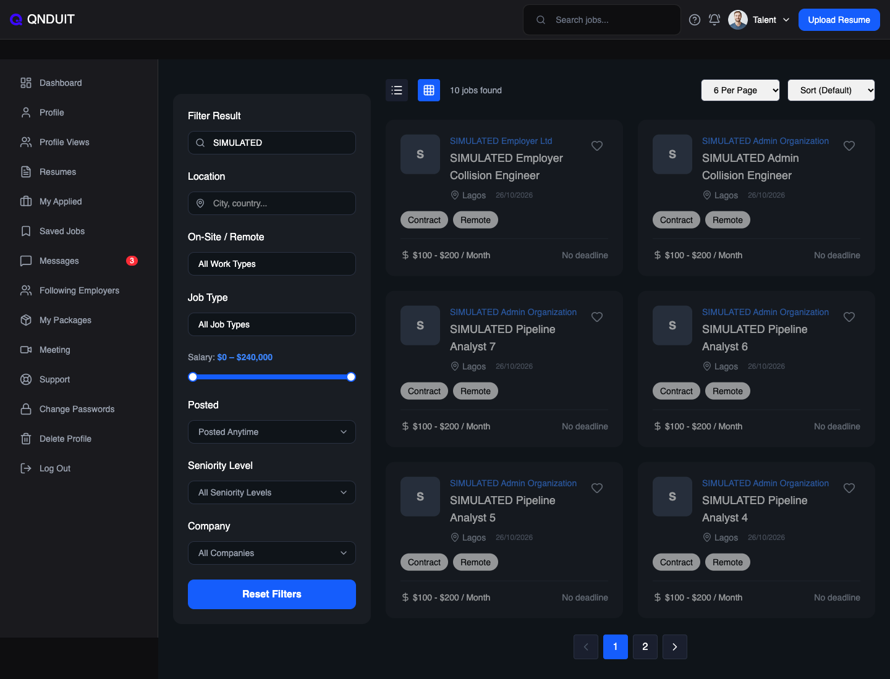
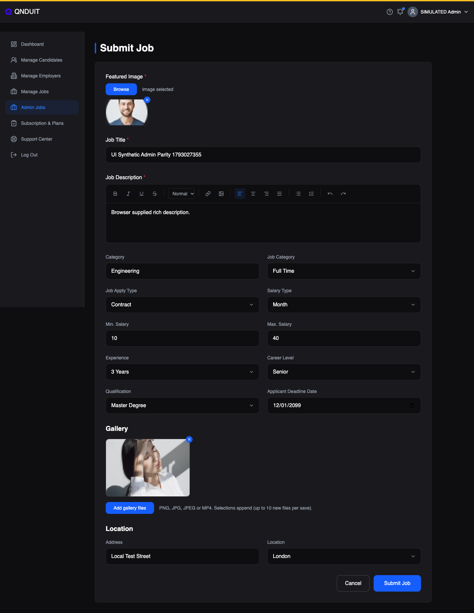
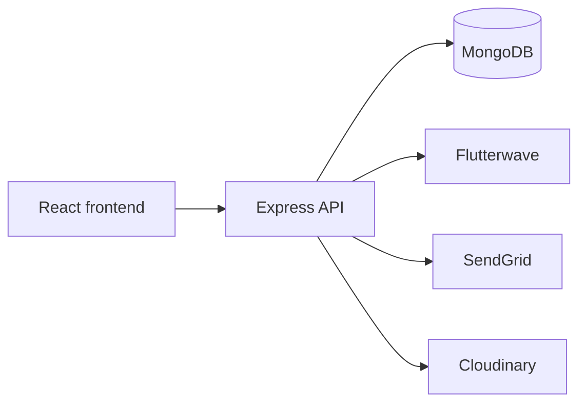

# QNDUIT

QNDUIT connects Talent and Employers through public profiles, jobs, applications, messaging and subscription plans. Admins manage accounts, jobs, subscriptions and Support. This document describes the repository.

## Table of contents

- [Quick start for reviewers](#quick-start-for-reviewers)
- [Interface examples](#interface-examples)
- [Architecture and stack](#architecture-and-stack)
- [Technology stack](#technology-stack)
- [Repository layout](#repository-layout)
- [Local setup](#local-setup)
- [Configuration](#configuration)
- [Authentication and access](#authentication-and-access)
- [Workflows and limitations](#workflows-and-limitations)
- [API reference](#api-reference)
- [Blog API](#blog-api)
- [Activity, discovery and Support contracts](#activity-discovery-and-support-contracts)
- [Data and operational readiness](#data-and-operational-readiness)
- [Verify the installation](#verify-the-installation)
- [Troubleshooting](#troubleshooting)
- [Contributing](#contributing)

---

## Quick start for reviewers

| Step | Action                                                                                                                                                                                  |
| ---- | --------------------------------------------------------------------------------------------------------------------------------------------------------------------------------------- |
| 1    | Install Node.js 22, npm and a transaction-capable MongoDB replica set.                                                                                                                  |
| 2    | Install the frontend and backend dependencies separately with `npm ci` in the repository root and in `backend/`.                                                                        |
| 3    | Copy `.env.example` to `backend/.env`, then configure a local database URI and JWT secret. Use test credentials for any provider you need.                                              |
| 4    | Start the backend from `backend/` with `npm run dev`; start Vite from the repository root with `npm run dev`.                                                                           |
| 5    | Before using the browser, set a local `VITE_API_BASE_URL` and address the production-only CORS origins described in [Local setup](#local-setup). Otherwise the local frontend may contact production. |
| 6    | Check the server logs and browser Network panel. External services and transactional features require their own configuration and readiness checks.                                     |

See [Local setup](#local-setup) and [Configuration](#configuration) for details and limitations.

---

## Interface examples

These screenshots were captured during local testing with synthetic job and Admin data. They illustrate the interface; they are not evidence of production deployment or provider delivery.

<details>
<summary>Talent job discovery: Employer and Admin jobs</summary>



</details>

<details>
<summary>Admin job creation form</summary>



</details>

## Architecture and stack

The Vite frontend is a React 19 single-page application with React Router, Tailwind CSS, Axios and Radix UI components. The backend is an Express 5 API running on Node.js, using Mongoose and MongoDB. Authentication uses JWTs and bcrypt. Flutterwave handles the mounted payment flow, SendGrid sends email; Cloudinary stores uploaded media and authenticated message attachments. Leaflet/OpenStreetMap support map UI. The current deployment uses a cPanel-hosted frontend and Railway backend; deployment and external-service settings are managed separately from this repository.

The browser calls the Express API, which checks identity and role, reads or writes MongoDB, and calls providers for payments, email and media. Subscription activation and other multi-document workflows use MongoDB transactions. A transaction-capable replica set or sharded deployment is therefore needed for those workflows; a standalone MongoDB server is insufficient.

## Technology Stack

| Area                        | Technologies                                                             |
| --------------------------- | ------------------------------------------------------------------------ |
| Frontend                    | React 19, Vite, React Router, JavaScript                                 |
| Styling and UI              | Tailwind CSS, Radix UI, Lucide React, React Icons, Framer Motion, Sonner |
| Frontend utilities          | Axios, Zod, DOMPurify, date-fns, Day.js                                  |
| Charts and maps             | Recharts, Leaflet, React Leaflet, OpenStreetMap                          |
| Backend                     | Node.js, Express 5                                                       |
| Database                    | MongoDB, Mongoose                                                        |
| Authentication and security | JWT, bcrypt, Helmet, CORS, express-rate-limit, express-validator         |
| Payments                    | Flutterwave                                                              |
| Email                       | SendGrid                                                                 |
| Media and attachments       | Cloudinary, Multer, private server-side staging                          |
| Deployment                  | cPanel for the frontend; Railway for the backend                         |
| Development tools           | npm, ESLint, Nodemon, Git, GitHub                                        |



## Repository layout

| Path                                                                 | Purpose                                                    |
| -------------------------------------------------------------------- | ---------------------------------------------------------- |
| `src/App.jsx`                                                        | Frontend routes and dashboard entry points                 |
| `src/components/auth/`                                               | Signup and sign-in interfaces                              |
| `src/components/{talentDashboard,employerDashboard,adminDashboard}/` | Role-specific interfaces                                   |
| `src/components/pages/`, `profiles/`, `home/`                        | Public pages and profile components                        |
| `src/components/utils/`                                              | API base, session, request and feature helpers             |
| `public/`                                                            | Static assets                                              |
| `backend/src/app.js`, `server.js`                                    | API composition and process entry point                    |
| `backend/src/routes/`, `controllers/`                                | Mounted endpoints and request handling                     |
| `backend/src/models/`, `services/`                                   | MongoDB models and business workflows                      |
| `backend/src/middleware/`, `utils/`, `config/`                       | Authorization, uploads, provider helpers and configuration |
| `backend/src/scripts/`, `backend/scripts/`                           | Operational scripts and packaging checks                   |

## Local setup

1. Install Node.js 22, npm and a local MongoDB replica set. Use isolated test accounts and provider sandbox credentials.
2. From the repository root run `npm ci`; then run `cd backend && npm ci`.
3. Copy the root example to the backend: `cp .env.example backend/.env`. Set a local `MONGO_URI` and a strong `JWT_SECRET`; configure only the external services needed for your test. The backend loads `.env` from its working directory, so start it from `backend/`.
4. Create a private staging directory if testing attachments, for example `mkdir -p /tmp/qnduit-private-attachments && chmod 700 /tmp/qnduit-private-attachments`. Ensure it is outside the application and public directories and accessible by the backend user. Provision the required indexes separately as described below.
5. Run `cd backend && npm run dev` in one terminal. In another, from the root run `npm run dev`. The backend defaults to port 5000 and Vite normally uses 5173.
6. **Local browser integration needs configuration work:** set `VITE_API_BASE_URL` when starting Vite to select an isolated local API; the existing deployed API remains the default when the variable is absent. `backend/src/app.js` only allows the QNDUIT production origins, so use an approved local proxy or local-only CORS configuration. Check the Network panel before testing; do not commit production credentials or exercise production accounts.

`npm run build` builds the frontend. `cd backend && npm run build` checks backend package/import integrity; it does not establish provider or database readiness. `npm run lint` runs frontend lint. The backend `npm test` script is a placeholder and intentionally fails; it is not an automated test suite.

**Secrets:** the example contains placeholders only. The existing `.gitignore` does not automatically exclude every `.env` file, so explicitly check `git status` before staging and never add local credentials. Create an Admin only in an isolated environment with the reviewed `backend/src/scripts/createAdmin.js` script and `ADMIN_*` values; do not use its credentials outside that environment.

## Configuration

`.env.example` lists names used by the source. Copy it to `backend/.env`, not the frontend. No real values belong in Git.

| Variables                                                                                                                                                       | Purpose / requirement                                                                                                                          |
| --------------------------------------------------------------------------------------------------------------------------------------------------------------- | ---------------------------------------------------------------------------------------------------------------------------------------------- |
| `MONGO_URI`, `JWT_SECRET`                                                                                                                                       | Database connection and signing/verification of access tokens; required for normal operation.                                                  |
| `PORT`, `NODE_ENV`                                                                                                                                              | HTTP port (default 5000) and runtime mode.                                                                                                     |
| `FRONTEND_URL`, `BACKEND_URL`                                                                                                                                   | URLs used in password-reset, job and payment callback flows; use environment-appropriate URLs.                                                 |
| `SENDGRID_API_KEY`, `SENDGRID_FROM_EMAIL`, `CONTACT_RECEIVER_EMAIL`                                                                                             | SendGrid credentials/sender and contact-message recipient. Required for the relevant email flows.                                              |
| `FLW_SECRET_KEY`, `FLW_SECRET_HASH`, `FLW_TALENT_PUBLIC_PLAN_ID`, `FLW_EMPLOYER_BRONZE_PLAN_ID`, `FLW_EMPLOYER_SILVER_PLAN_ID`, `FLW_EMPLOYER_PLATINUM_PLAN_ID` | Flutterwave API, webhook verification and plan IDs for paid checkout.                                                                          |
| `CLOUDINARY_CLOUD_NAME`, `CLOUDINARY_API_KEY`, `CLOUDINARY_API_SECRET`                                                                                          | Cloudinary media and private attachment storage.                                                                                               |
| `MESSAGE_ATTACHMENTS_ENABLED`, `MESSAGE_ATTACHMENT_STORAGE`, `MESSAGE_ATTACHMENT_DIR`                                                                           | Attachments require exactly `true`, `cloudinary`, and a private absolute staging path, plus provider and index readiness. Disabled by default. |
| `MESSAGE_UNREAD_SINCE`                                                                                                                                          | Empty disables unread counts; otherwise use an exact ISO UTC timestamp such as `2026-10-27T00:00:00.000Z`. It sets the rollout cutoff.         |
| `NOTIFICATION_CAPTURE_ENABLED`, `NOTIFICATION_DELIVERY_ENABLED`                                                                                                 | Separate opt-in capture and delivery switches; enabled only with exact `true`.                                                                 |
| `ADMIN_NAME`, `ADMIN_EMAIL`, `ADMIN_PASSWORD`                                                                                                                   | Admin creation script only.                                                                                                                    |
| `STRIPE_SECRET_KEY`, `STRIPE_WEBHOOK_SECRET`                                                                                                                    | Legacy Stripe code; do not assume the unmounted handlers are active payment integrations.                                                      |

Changing environment variables requires restarting/redeploying the backend process. Provider credentials being present does not prove that a provider operation works.

## Authentication and access

Talent and Employer register, verify their email and sign in through the respective signup endpoints and shared login; Admins use their own login. Password reset uses an emailed link. Protected API requests use `Authorization: Bearer <token>`; middleware verifies the account and role, and controllers apply ownership/status restrictions. Token expiration is 30 days for Talent/Employer and seven days for Admin. Suspended accounts have restricted access, including their own Support flow; deleted or invalid accounts cannot continue authenticated use. See `authMiddleware.js`, `accountAccess.js`, and route/controller checks for the exact policy.

Paid and verified/publication rules govern Talent public visibility. Employer messaging requires an eligible active Silver or Platinum subscription; Bronze and Free do not gain access. The free/ineligible Employer job limit counts stored jobs, including certain deleted records; eligible paid plans have different limits. Check the current policy and server response instead of trusting frontend visibility alone.

## Workflows and limitations

- **Talent:** manage profile/resume, gallery, education, experience and skills; discover jobs and Employers; save and apply to jobs; manage meetings, messages and Support. Public Talent routes expose an allowlisted profile only when publication eligibility is satisfied.
- **Employer:** manage company profile, post and manage Employer jobs, review Employer-job applications, follow/save Talent, schedule meetings, select plans and use eligible messaging.
- **Admin:** manage Talent and Employer accounts and Employer jobs; create/manage Admin jobs in a separate collection. Published Admin jobs enter the shared job discovery/application flow. Applications are stored separately; an Admin application review page and Admin application list/detail/count endpoints are not implemented in this revision. Job attribution uses the authenticated Admin ID.
- **Subscriptions:** Flutterwave callbacks/webhook use the shared activation lifecycle. After a successful transaction, a durable confirmation event is dispatched via SendGrid; provider acceptance is not proof of inbox delivery. Admin invoice preview/send uses linked subscription/payment records. Invoice amounts are stored checkout amounts and `paidAt` is application activation time, not necessarily provider settlement evidence. Cancellation removes application access; it does not by itself stop provider billing or refund. Downgrade is recorded as pending, not automatically applied.
- **Messages:** authenticated participants can send text and, when configured, attachments. Employer access is checked separately. Private downloads validate participant identity. Attachment processing also requires Cloudinary, secure staging and the declared unique Message index. Recovery is started by the backend process; validate storage durability and provider operations during deployment.
- **Support:** Talent/Employer tickets are scoped to their owner; Admins manage them. Older email-only tickets may need explicit ownership reconciliation. Notifications and unread counts have separate rollout switches.

## API reference

All paths below start with `/api`. `Public` means no route-level login; individual controllers may validate additional input. `T`, `E`, `A` mean authenticated Talent, Employer and Admin; `Auth` means authenticated with additional controller checks. Source, ownership, verification, subscription and rate-limit checks still apply. `:id` and other colon-prefixed fields are path parameters. Inspect the matching route and controller for the complete request validation and response shape.

| Method and path                                                                                                                                                                                                          | Access                               | Purpose                                                                         |
| ------------------------------------------------------------------------------------------------------------------------------------------------------------------------------------------------------------------------ | ------------------------------------ | ------------------------------------------------------------------------------- |
| `POST /auth/login`, `/auth/forgot-password`, `/auth/reset-password/:token`                                                                                                                                               | Public                               | Sign in and password reset                                                      |
| `GET /auth/session`                                                                                                                                                                                                      | T/E                                  | Current session identity/status                                                 |
| `POST /admin/auth/login`                                                                                                                                                                                                 | Public                               | Admin sign-in                                                                   |
| `PATCH /admin/auth/{talents,employers}/:id/verification`                                                                                                                                                                 | A                                    | Set verification                                                                |
| `POST /talents/register`, `/talents/verify`                                                                                                                                                                              | Public                               | Talent signup and email verification                                            |
| `POST /talents/resume`; `PUT /talents/:id/profile`, `/talents/:id/plan`, `/talents/update`                                                                                                                               | Auth; profile/plan T                 | Talent resume/profile/plan                                                      |
| `GET /talents/profile`, `/talents/search-by-email`                                                                                                                                                                       | Auth; search E                       | Current profile / Employer search                                               |
| `GET /talents/:id/dashboard`, `/talents/public`, `/talents/public/:username`                                                                                                                                             | Public route                         | Dashboard data and eligible public profiles                                     |
| `POST /employers/signup`, `/employers/verify`                                                                                                                                                                            | Public                               | Employer signup / verification                                                  |
| `PUT /employers/update`; `GET /employers/profile`, `/employers/messaging-access`, `/employers/subscription`; `POST /employers/pay`                                                                                       | E                                    | Profile, entitlement and checkout                                               |
| `GET /employers/saved-candidates`; `POST`, `DELETE /employers/saved-candidates/:id`                                                                                                                                      | E                                    | Saved Talent                                                                    |
| `POST /payments/create-checkout`; `GET /payments/subscription`                                                                                                                                                           | Auth                                 | Talent checkout / subscription                                                  |
| `POST /payments/employer/create-checkout`, `/payments/employer/pay-later`; `GET /payments/employer/subscription`                                                                                                         | Auth                                 | Employer checkout, unpaid selection and subscription; controller validates role |
| `GET /payments/callback`, `/payments/employer/payment/callback`; `POST /payments/flutterwave/webhook`                                                                                                                    | Public provider entry                | Verify provider callback/webhook; never treat unverified input as payment proof |
| `GET /jobs`, `/jobs/search`, `/jobs/suggest`, `/jobs/public/:id`, `/jobs/related/:id`                                                                                                                                    | Public                               | Search and public job details                                                   |
| `POST /jobs/create`; `PUT /jobs/update/:id`; `DELETE /jobs/delete/:id`; `GET /jobs/my-jobs`, `/jobs/:id`                                                                                                                 | E                                    | Employer-owned job management                                                   |
| `POST /jobs/:id/contact`                                                                                                                                                                                                 | Auth                                 | Contact Employer job poster, subject to limits                                  |
| `POST /applications/apply`; `GET /applications/my-applications`                                                                                                                                                          | T                                    | Apply and view own history; body includes `jobId` and source for Admin jobs     |
| `GET /applications/job/:jobId`, `/applications/employer`; `PATCH /applications/:applicationId/archive`, `/applications/:applicationId/status`                                                                            | E                                    | Employer job applications only                                                  |
| `GET`, `POST /saved-jobs`; `POST /saved-jobs/remove-job`                                                                                                                                                                 | Auth                                 | Saved jobs; explicit source distinguishes Admin and Employer jobs               |
| `POST /meetings/create`; `PUT /meetings/update/:id`; `GET /meetings/my-meetings`, `/meetings/:id`; `DELETE /meetings/delete/:id`                                                                                         | E                                    | Employer meeting management                                                     |
| `GET /meetings/talent-meetings`; `DELETE /meetings/cancel/:id`                                                                                                                                                           | T                                    | Talent meetings                                                                 |
| `PUT`, `GET /resume`                                                                                                                                                                                                     | Auth                                 | Save or retrieve own resume                                                     |
| `POST /messages/send`, `/messages/heartbeat`, `/messages/presence`; `GET /messages`, `/messages/chats`, `/messages/search`, `/messages/unread`, `/messages/:messageId/attachments/:attachmentId`; `PATCH /messages/read` | T/E; Employer requires eligible plan | Messages, presence, unread acknowledgements and authorized attachments          |
| `GET /follows/employers/search`, `/follows/employers/following`, `/follows/status/:employerId`; `POST`, `DELETE /follows/employers/:employerId`                                                                          | T                                    | Discover and follow Employers                                                   |
| `GET /follows/talents/followers`, `/follows/talents/following`; `POST`, `DELETE /follows/talents/:talentId`                                                                                                              | E                                    | Employer follow workflows                                                       |
| `POST /support/tickets`, `/support/tickets/:ticketId/replies`; `GET /support/tickets/mine`                                                                                                                               | T/E                                  | Own Support tickets                                                             |
| `GET /support/admin/tickets`; `PATCH /support/admin/tickets/:ticketId/status`; `POST /support/admin/tickets/:ticketId/replies`; `DELETE /support/admin/tickets/:ticketId`                                                | A                                    | Support administration                                                          |
| `GET /profiles/:userType/:userId`, `/profiles/:userType/:userId/views`, `/profiles/:userType/:userId/views/summary`; `POST /profiles/:userType/:userId/views`                                                            | Verified T/E                         | Profiles and view tracking; ownership checks apply                              |
| `GET /notifications`; `POST /notifications/read-displayed`, `/notifications/:id/read`                                                                                                                                    | T/E                                  | Notifications when rollout is enabled                                           |
| `PUT /gen/change-password`; `DELETE /gen/delete-account`; `GET /gen/search`                                                                                                                                              | Auth                                 | Account utilities                                                               |
| `GET /gen/stats`; `POST /contact`                                                                                                                                                                                        | Public                               | Public statistics and contact form                                              |
| `GET /admin/dashboard`, `/admin/talents`, `/admin/talents/:id`, `/admin/employers`, `/admin/employers/:id`                                                                                                               | A                                    | Dashboard and account records                                                   |
| `PATCH /admin/{talents,employers}/:id/status`, `/admin/{talents,employers}/:id/verification`; `DELETE /admin/{talents,employers}/:id`                                                                                    | A                                    | Account management                                                              |
| `GET /admin/jobs`, `/admin/jobs/:id`; `PATCH /admin/jobs/:id/flag`; `DELETE /admin/jobs/:id`                                                                                                                             | A                                    | Manage Employer jobs                                                            |
| `GET`, `POST /admin/posted-jobs`; `GET`, `PATCH`, `DELETE /admin/posted-jobs/:source/:id`; `PATCH /admin/posted-jobs/:source/:id/status`, `/admin/posted-jobs/:source/:id/flag`                                          | A                                    | Separate Admin jobs; source identifies Admin job records                        |
| `GET /admin/subscriptions/stats`, `/admin/subscriptions`, `/admin/subscriptions/:type/:id`; `GET`, `POST /admin/subscriptions/:role/:accountId/{invoice-email,cancel,downgrade}`                                         | A                                    | Subscription records, previews and actions                                      |

For example, a Talent applying to an Admin job sends `POST /api/applications/apply` with a bearer token and JSON `{"jobId":"<job-id>","source":"admin"}`. Successful creation returns an application object; invalid identity, source or eligibility is rejected. Error responses generally include a `message` and may include `success: false`; exact statuses and payloads vary by controller. Do not infer unrestricted access from an endpoint's name.

## Blog API

Blog routes use `/api` as their prefix. Public routes need no credentials; Admin
routes require the existing active Admin Bearer session before multipart parsing.
Existing static articles `/blog/1`–`/blog/9` are retained separately from MongoDB
ObjectId blog records. Admin Blog Management is `/admin-dashboard/blog`.

| Endpoint | Contract |
| --- | --- |
| `GET /api/blog?page=1&limit=10` | Published posts only; newest publication first with descending ID tie-breaker. |
| `GET /api/blog/:id` | Published detail; missing, malformed or draft IDs return 404. |
| `GET /api/admin/blog?page=1&limit=10` | All statuses, newest creation first. |
| `GET /api/admin/blog/:id` | Fresh saved fields and revision, including Drafts. |
| `POST /api/admin/blog` | Multipart creation; returns 201 with `{ success: true, post }`. |
| `PATCH /api/admin/blog/:id` | Multipart edit; returns 200 with `{ success: true, post }`. |
| `DELETE /api/admin/blog/:id` | JSON `{ "revision": <non-negative integer> }` only; permanently deletes a database post and returns 200 `{ success: true, id }`. Active Admin required. |
| `PATCH /api/admin/blog/:id/publish` | Empty body or `{}`; atomically publishes a Draft. Repeating preserves the publication timestamp. |

Lists return `{ success: true, data: [...], pagination: { page, limit, total,
totalPages } }`; defaults are page 1/limit 10, maxima page 10000/limit 50. Only
`page` and `limit` query fields are accepted; empty results have totalPages 1.
Public posts expose `id`, `title`, `excerpt`, `category`, `author`, cover `image`
URL and `publishedAt`; detail adds `content`. Admin posts also include `content`,
`status`, `revision`, `createdBy`, `createdAt`, `updatedAt`; neither exposes cover
storage IDs. The public frontend requests six records per page and retains the
original featured article and static content during service failures.

Create requires plain-text `title` (1–200 characters), `excerpt` (1–500),
`category` (1–80), `author` (1–120), `content` (JSON block array) and one
`coverImage` file. Optional `status` is `draft` (default) or `published`. Drafts
require the same complete article fields. Edit requires all five article fields
plus the saved nonnegative integer `revision` (canonical decimal string in
multipart); `coverImage` is optional. Omitting a replacement retains the current
cover. Cover removal is unsupported. Identity, ID, status and timestamp fields
are rejected on edit; publication changes use the separate publish endpoint.

Content has 1–200 blocks, at least one text block and at most 100000 characters
total. Text blocks allow 1–10000 characters and no HTML. Supported shapes are
`{type:"paragraph"|"heading"|"quote",text:"..."}` and
`{type:"image",src:"https://res.cloudinary.com/<cloud>/image/upload/..."}`.
All blog image URLs use the same policy: HTTPS public Cloudinary image/upload
delivery, no URL credentials, query strings or fragments. Authenticated/private,
raw/fetch delivery and token-bearing URLs are rejected. Unsafe previously stored
cover/content causes a generic 503 from public listing/detail without echoing
URLs or tokens; authorized Admins can load legacy article fields to repair them.

Covers accept JPEG/PNG up to 10 MiB and 40 megapixels, with matching MIME/name,
signature and decoding checks. They are auto-oriented, metadata-stripped,
resized within 2400×2400 and re-encoded before upload through the shared
Cloudinary client. Existing covers are retained; only this operation's new asset
is eligible for cleanup on a definite failure. Uncertain DB outcomes retain it.

Creator/creation date, ID and publication timestamp are server-controlled.
Edits atomically compare/increment revision; publication increments it once.
Legacy missing revisions read as zero. Conflicts return 409 and require reload.
Creation has no idempotency key: every ambiguous 5xx (including 502), lost
acknowledgement or invalid success response keeps the client write lock. No
uncertain write is automatically retried. Creation requires explicit refreshed
list review; editing requires explicit saved-record reload before another write.
The current API has no verified 5xx pre-write rejection code, so provider 502
responses are conservatively treated as uncertain too.

Errors use `{success:false,message,errors?}`: validation 400, auth 401/403,
not-found 404, revision conflict 409, oversize cover 413, provider failure 502,
unconfirmed/unavailable operation 503. Admin responses use private/no-store;
public responses use no-store. Deletion returns 404 for missing/already-deleted posts and 409 for a stale revision; legacy missing revisions match zero. Cloudinary covers and inline images are retained, and static articles 1–9 are unaffected. Admin deletion loads fresh details before confirmation; conflicts or uncertain outcomes require a read-only refresh and fresh confirmation, with no automatic retry. Confirmed deletion refreshes the list/count and reconciles an emptied final page. Already-loaded public pages may retain content until refetched; subsequent API detail requests return 404. No unpublish or scheduling API is included.

The `blogposts` model disables automatic collection/index provisioning. Review
`{status:1,publishedAt:-1,_id:-1}` and `{createdAt:-1,_id:-1}` before rollout;
no production provisioning or migration is performed by this feature. Compatible
backend/frontend releases are required.

Retained frontend regression coverage uses synthetic data and mocked requests:

```sh
node --test src/components/utils/adminBlog.test.js src/components/utils/publicBlog.test.js
```

These tests do not establish real MongoDB/Cloudinary delivery. Browser/provider/
deployment verification remains separate. Backend regression suites and fixtures
were removed by explicit owner choice after their final run; backend automated
coverage is no longer included. The backend npm test script remains a failing
placeholder. Temporary EN500F browser infrastructure was also removed.

## Activity, discovery and Support contracts

These production contracts and operational prerequisites are retained from the
former backend documentation. Their consolidation does not change API behavior.

### External application recording and readiness

`POST /api/applications/external-activities` requires an authenticated active
Talent. Body: `{jobId:"<ObjectId>",source:"employer"|"admin",intentId:"<UUID v4>",
expectedDestination:"<exact destination URL>"}`. Client actor/poster IDs and dates
are not accepted. Server-selected job data supplies ownership and destination;
the expected destination must match byte-for-byte, including query encoding and
fragments. The server does not fetch that URL. Availability uses the existing
published, strictly nondeleted, Lagos-deadline and External-configuration checks.

Use a fresh intent for each deliberate activation; preserve the same UUID and
payload for retries and lost acknowledgements. New records return 201; matching
replays return 200 with `replayed:true`; conflicting reuse or a changed destination
returns 409 with distinct codes. Replay precedes checks of later job edits/removal.
Server `clickedAt` records an Apply activation, never application completion.
Internal applications, applicant counts and notifications are unaffected.

Automatic collection/index creation is disabled. Before enabling callers, an
operator must explicitly select the intended database through
`EXTERNAL_ACTIVITY_DATABASE_URI` and run from `backend/`:

```sh
node src/scripts/provisionExternalApplicationActivity.js
```

This command loads no `.env` and starts no application/providers. It creates only
the collection and declared indexes additively; it never drops indexes. Existing
duplicates/incompatible definitions require separate resolution. Required
recording protection is the nonpartial, nonsparse unique
`external_activity_talent_intent_unique` index on `{talentId:1,intentId:1}` with
simple collation. Every recording request checks it without caching; missing
collection/protection or unavailable index inspection returns 503
`EXTERNAL_ACTIVITY_NOT_READY` before insertion. Never remove protection while
callers are active. The deterministic SHA-256 Talent/intent `_id` additionally
protects in-flight concurrency; it does not bypass readiness checks.

The declared Talent/time index supports history. The additive
`external_activity_source_time` index `{source:1,clickedAt:-1,_id:-1}` supports
Admin reads. `external_activity_employer_figures` is nonunique on
`{posterId:1,posterType:1,source:1,jobId:1,talentId:1}`. Rerun the same provisioning
command before the relevant rollout, then deploy the backend endpoint before its
frontend caller. These read indexes introduce no additional recording-readiness
gate. No provisioning is performed by this README or repository cleanup.

### Talent feed and analytics boundaries

`GET /api/applications/activity-feed` requires Talent authentication. Queries:
`q` is literal case-insensitive search (maximum 200 characters); `type` is
`all|internal|external`; `source` is `all|employer|admin`; `page` defaults to 1,
maximum 100000; `limit` defaults to 20, maximum 50. All records are scoped to the
authenticated Talent before combining/filtering and global pagination. Ordering
is `occurredAt DESC,id DESC`; pagination returns page, limit, total and totalPages.

Internal rows retain existing statuses and appliedAt/createdAt fallback. External
rows group by job and source and use the latest complete event selected by
`clickedAt DESC,_id DESC`, with lifetime `totalOpens`. Search examines that latest
snapshot/destination, not older events, and does not reduce totalOpens. Stable
External identities are `external:<source>:<jobId>`. Totals count Internal rows
plus External groups, not individual clicks. Removed/closed jobs retain history;
current source-specific existence controls View Job availability. Response fields
are allowlisted (identity, kind/source/label, job existence, time, status,
destination/image and display fields); External rows have no Internal status.
Recorded destinations are copied exactly and opened only as validated HTTP(S)
links. Feed errors return 503 rather than partial history. Offset pages can move
as activity arrives. The default my-applications response remains Internal-only.

`GET /api/applications/my-applications?summaryOnly=true` returns `success`,
`totalApplications` (both Internal collections), `externalJobGroups` (distinct
job/source pairs) and `externalOpens` (individual events). These lifetime counts
are owner-scoped and independent of feed filters or current job existence.
Failures return 503; responses are private/no-store, never fabricated zero totals.

### Employer and Admin activity figures

`GET /api/jobs/my-jobs` adds per-job `externalTalents` and `externalClicks` in one
batch, with zero defaults. `GET /api/applications/employer?summaryOnly=true` adds
global distinct Talents and all-event counts; global distinctness is not a sum of
per-job distinct counts. Both first match authenticated poster ID,
`posterType:Employer,source:employer`. Removed/closed/edited jobs retain history.
Only counts and batch job IDs leave aggregation; event identities/destinations
remain private. Existing Internal totals, applicant counts and sorting retain
their meanings. Responses are private/no-store; failures do not manufacture zeros.

`GET /api/admin/posted-jobs/external-activities` requires an active Admin and fixes
source to Admin. It is global across Admin posters. Query: literal `q` (max 200),
optional jobId, page 1–100000 and limit 1–50 (default 20). Client source/owner
overrides are rejected. Filters precede pagination; ordering is
`clickedAt DESC,_id DESC`. Output includes only activity/source/time/destination,
Talent ID/current name or unavailable fallback, and recorded job display fields.
Removed entities retain audit history. `summary:{externalTalents,externalClicks}`
uses the same filtered aggregation across all pages; clicks equals pagination
total. `summaryScope:{source:"admin",q,jobId}` describes that scope. No Internal
application counts are included.

Private polling remains owner/token/filter-scoped: nonoverlapping 15-second
visible/online reads, focus/reconnect wake, cancellation, failure backoff up to
60 seconds and shared 429 cooldowns. Initial failures display unavailable figures;
refresh failures retain figures only for the same owner/filter. Account changes
discard stale private responses; Talent/Admin sessions remain independently
scoped. Mutations are never queued/replayed by polling. Lifetime aggregates still
scale with matching history; local synthetic index evidence is not a production
performance guarantee. Review representative query plans before rollout; no
automatic index reconciliation or additional analytics provisioning is implied.

### Authenticated Explore Talents filters

`GET /api/gen/search?userType=talent` accepts scalar `skill` and `category`, each
at most 200 trimmed characters. Empty values disable filters; repeated/non-string
or oversized values return 400. Skill matches an exact Talent.tags value OR
Resume.skills[].title; category matches an exact Talent.categories member.
Matching ignores case and surrounding whitespace, preserving internal spacing,
punctuation and literal regex characters. No stemming, substring/alias expansion
or comma splitting occurs. Skill AND category AND the existing filters apply
before pagination/counting; Resume duplicates do not duplicate Talents.

Portfolio project skills are excluded. Existing name/title keyword behavior,
mixed search and public discovery remain unchanged. Visibility requires
showProfile=show, verified and not suspended; public subscription eligibility is
not required. Existing projection remains allowlisted; CV/Resume/private matching
fields are not exposed. Filter changes reset pagination and participate in
owner/token request cancellation. Review Resume.talent lookup/index coverage
before scaling; this feature introduces no index provisioning.

### Support attachments, private delivery and recovery

Support replies accept message text up to 10000 characters and up to five
JPG/JPEG/PNG files, at most 10000000 bytes per file and 25000000 bytes total.
Multipart fields are `message`, `clientReplyId` (16–128 URL-safe letters/digits/
underscore/hyphen) and repeated `attachments`; JSON text-only requests support
the same key. File-only replies are allowed. Legacy text-only clients without
keys remain compatible; deduplication requires a stable key. Structural image,
extension, count, individual/combined size and request limits are enforced; this
is not antivirus scanning or a full decoder.

`GET /api/support/tickets/:ticketId/replies/:replyId/attachments/:attachmentId`
serves authorized downloads (`?view=1` for inline). Every read checks authenticated
ownership or active Admin access. Suspended owners retain narrow Support access;
Employer messaging subscriptions do not gate Support. Email-only legacy tickets
are not assigned ownership; legacy dates/history remain unchanged. DTOs expose
only attachment id/name/mime/size, never provider URLs, storage keys or checksums.
Browsers fetch authenticated bytes and use temporary blob previews.

`SupportReplyOperation` reserves a hash of ticket/actor ID/role/client key through
its default unique `_id` index, with majority write concern before uploads. No
extra TTL/index is required. Fingerprints cover trimmed text and validated file
name/type/size/SHA-256; reuse with different content is rejected. Atomic append
guards preserve all existing replies/status. Keep the same key/text/file snapshot
through uncertain sends and retries; a deliberate new reply uses a fresh key.

Confirmed precommit failures discard only their own uploads; confirmed commits
remove temporary staging but retain assets. Unknown upload/DB outcomes retain
assets, intent files and operation records. An absent read is not proof of
noncommit. Pending retries do not reupload; stored majority-read confirmation can
resolve an operation. Only a confirmed failed operation with discarded assets
can be reclaimed. Never delete an uncertain operation to unblock retry: there is
no timeout lease or automatic destructive cleanup. Support assets are outside
the message recovery worker; ticket deletion does not delete committed assets.

Disabled by default. Enable only with `SUPPORT_ATTACHMENTS_ENABLED=true`,
`SUPPORT_ATTACHMENT_STORAGE=cloudinary`, existing Cloudinary credentials and
`SUPPORT_ATTACHMENT_DIR` as a private absolute path outside the app. Keep Support
and messaging staging directories separate and nonnested; preserve staging and
operation records across restarts. Storage uses shared authenticated raw/private
delivery with server-side streaming and redirects disabled. Real provider
permissions, durable staging and interrupted-operation reconciliation require
separate environment verification; mocked evidence does not establish readiness.

## Data and operational readiness

| Models                                                                                             | Main relationships and purpose                                                                                                                                      |
| -------------------------------------------------------------------------------------------------- | ------------------------------------------------------------------------------------------------------------------------------------------------------------------- |
| `Talent`, `Employer`, `Admin`, `Resume`                                                            | Account identity, role/status/verification, profiles and Talent resume data.                                                                                        |
| `Job`, `AdminJob`                                                                                  | Separate Employer and Admin job collections; Admin job `postedBy` references the authenticated Admin.                                                               |
| `JobApplication`, `AdminJobApplication`, `SavedJob`                                                | Talent-to-job relationships. Admin applications carry source, job, applicant, posting Admin, status and timestamps; they do not include a profile snapshot.         |
| `TalentPayment`, `EmployerPayment`, `TalentSubscription`, `EmployerSubscription`                   | Payment and plan records used to derive access and invoice evidence.                                                                                                |
| `SubscriptionLifecycle`, `SubscriptionCharge`, `SubscriptionCancellation`, `SubscriptionDowngrade` | Activation serialization and audit records. `SubscriptionConfirmation`, `SubscriptionEmailGate`, `SubscriptionEmailAttempt` track confirmation or invoice delivery. |
| `Message`, `MessagePresence`, `Notification`                                                       | Participant messages and attachments, presence and in-app notifications.                                                                                            |
| `SupportTicket`, `Follow`, `EmployerTalentFollow`, `Meeting`, `ProfileView`                        | Support ownership, follow relationships, meeting records and profile views.                                                                                         |

Indexes are part of operational setup, not just schema declarations. Several schemas explicitly disable automatic index/collection creation. Before rollout, inspect existing collections, data and indexes; arrange a reviewed migration, check duplicate keys and never blindly drop or synchronize production indexes. Notable requirements include:

- `Message`: unique partial `{ sender: 1, senderModel: 1, clientMessageId: 1 }` where `clientMessageId` has BSON type `string`, plus declared timeline and unread indexes.
- `AdminJob`: `{ isDeleted: 1, createdAt: -1, _id: -1 }`.
- `AdminJobApplication`: unique `{ jobId: 1, applicantId: 1 }` and `{ applicantId: 1, createdAt: -1 }`.
- `SubscriptionConfirmation`: `{ status: 1, nextAttemptAt: 1, _id: 1 }`; its `_id` is the event's unique key.
- `SupportTicket`, `Notification`, `ProfileView`, follow and application models declare additional access, uniqueness or reconciliation indexes. Review their schemas and operational requirements before enabling features.

Confirm collections and indexes exist before enabling dependent workflows. Recovery or readiness cannot be inferred from a successful server start. MongoDB transactions are required for subscription activation, Admin-job applications and other transactional paths. Test backups, configuration, provider sandbox behavior, authorization and recovery separately before deployment. Coordinate compatible frontend/backend releases and verify the served assets and live behavior afterward.

## Verify the installation

| Check             | What to verify                                                                                                                                       |
| ----------------- | ---------------------------------------------------------------------------------------------------------------------------------------------------- |
| Backend           | The server starts from `backend/`, connects to the intended MongoDB instance and listens on the configured port.                                     |
| Frontend          | Vite starts from the repository root and displays the application.                                                                                   |
| Browser requests  | The Network panel shows requests reaching the intended local API without CORS errors.                                                                |
| Transactions      | The MongoDB deployment supports transactions before testing subscription activation or Admin-job applications.                                       |
| Optional features | Check the required indexes, storage and provider credentials for the feature being tested. A successful server start alone does not prove readiness. |

## Contributing
